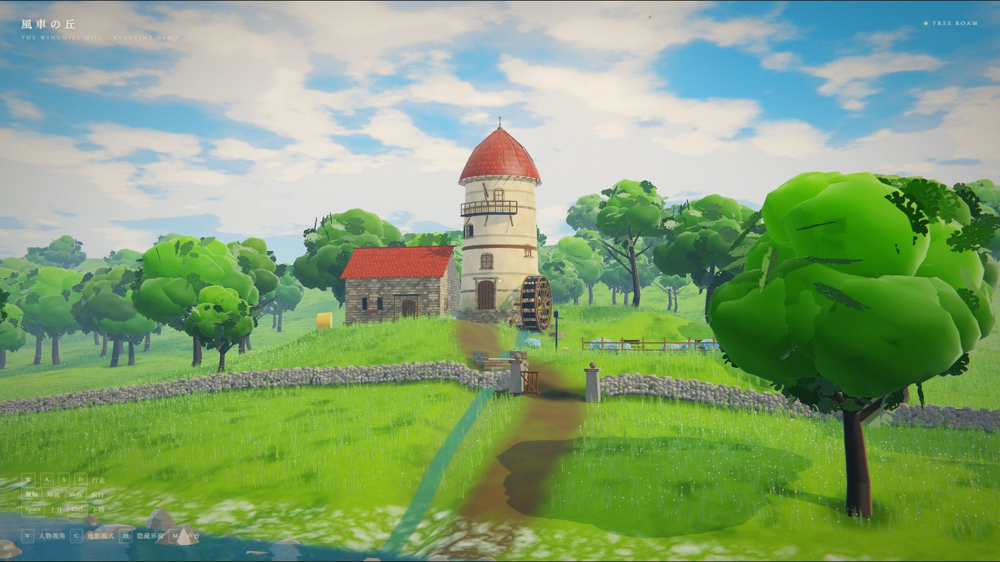
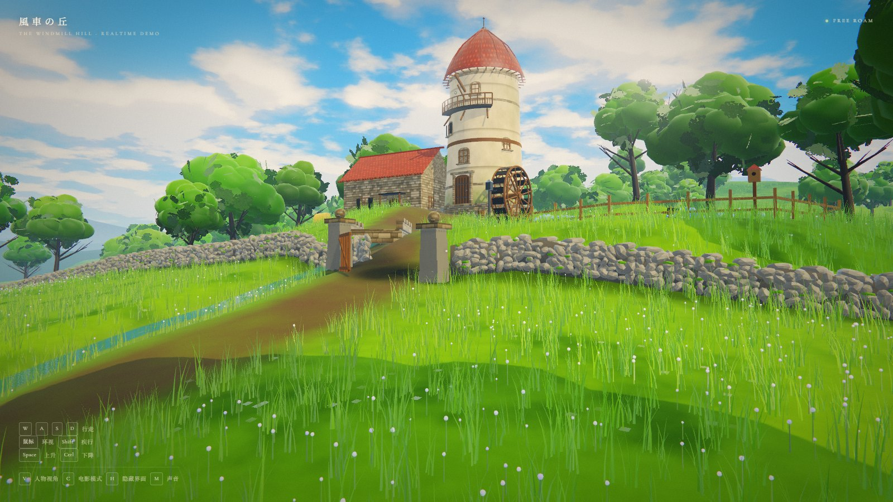
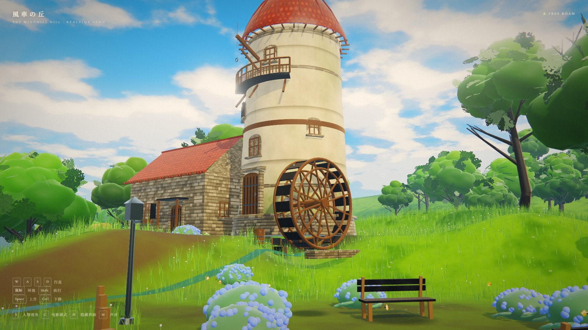
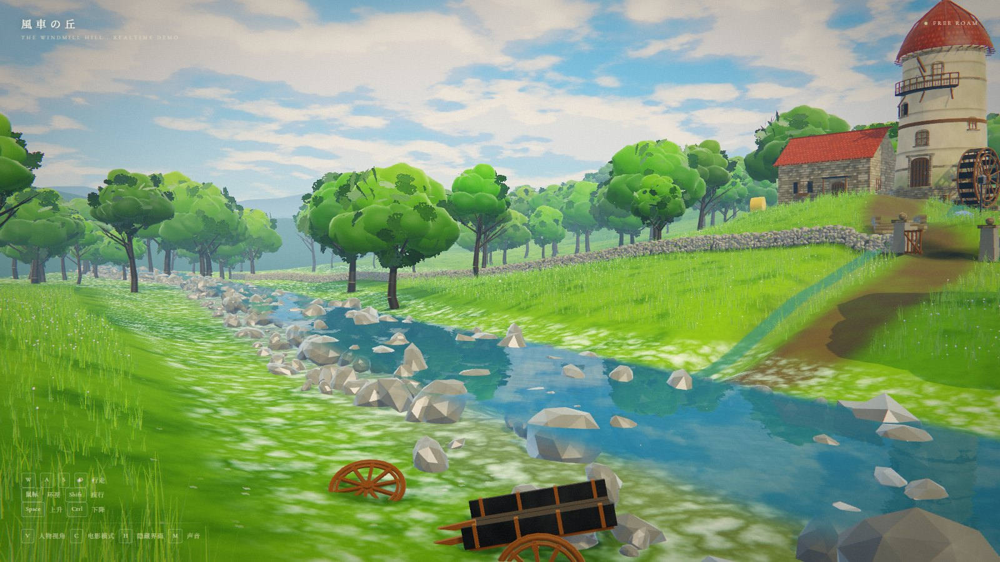

# 風車の丘 · The Windmill Hill

一个完全程序化生成的实时 3D 场景 Demo —— 风车、石墙、河谷、花园，参考吉卜力风格的动画背景重建。
**没有任何外部模型 / 贴图资源**：地形、建筑、植被、云、水面法线、石材与木纹全部在运行时用代码与 Canvas 生成。



| | |
|---|---|
|  |  |
|  | |

> 全部为浏览器实时渲染截图（1600×900），无后期合成。

---

## 运行

```bash
npm install
npm run dev      # http://localhost:5173
npm run build    # 产出 dist/
```

需要支持 WebGL2 的浏览器（Chrome / Edge / Firefox 均可）。

---

## 操作

| 键 | 功能 |
|---|---|
| 点击画面 | 进入第一人称漫游（指针锁定） |
| `W A S D` | 行走 |
| 鼠标 | 环视 |
| `Shift` | 疾行（3.2×） |
| `Space` / `Ctrl` | 上升 / 下降 |
| `V` | 切换 第一人称 / 人物（第三人称）视角 |
| `C` | 播放 / 退出电影镜头（8 个镜头，约 57 秒） |
| `H` | 隐藏界面 |
| `M` | 开启环境音（风、鸟、水） |

首次进入会自动播放完整的电影镜头序列，点击任意位置可跳过并进入漫游。

---

## 场景构成

**世界尺度 420 × 420 米，单位为真实米制。**

- **风车塔**：高 12.2 m、底径 7.1 m 的锥形石塔，红瓦穹顶、木质回廊、吊臂、四扇拱窗、石砌基座、水车（半径 2.3 m，实时旋转）
- **磨坊主屋**：8.4 × 5.9 m，山墙红瓦屋顶、烟囱、拱门、百叶窗、窗台花箱
- **干砌石墙**：约 200 m，5000+ 块独立石块实例化堆砌，含门柱与半开木栅门
- **河谷**：平面反射水面（实时镜像相机 + 斜裁剪）、法线波纹、深度着色、岸边泡沫、水下焦散、1200 块河石、5200 丛芦苇
- **花园**：绣球花丛、长椅、路灯、陶盆、鸟屋、木栅栏、小木桥
- **植被**：约 95,000 丛草（约 60 万片草叶，GPU 风场）、130 棵程序化树（含叶簇卡片）、11,000 朵野花
- **远景**：三层远山、程序化积云天空、大气透视
- **氛围**：1500 颗环绕相机包裹的花粉尘埃（逆光提亮）、8 只绕花丛飞舞的蝴蝶、6 只高空盘旋的鸟
- **后期**：屏幕空间体积光（太阳加权）、电影模式景深（焦点跟随注视点）、Bloom、ACES + 分离色调
- **人物**：程序化生成的小旅人（草帽、马甲、围巾、背包），层级骨骼 + 程序化步行动画（腿臂摆动、身体起伏、前倾、头部反向摆动），第三人称跟随相机带地形遮挡拉近与滚轮缩放

---

## 技术要点

### 渲染
- **自定义风格化着色器**（`src/core/materials.js`）：三段式卡通光照 + 冷调阴影 + 菲涅尔天空反射（按反射向量取天空梯度，带太阳高光）+ 边缘光 + 叶片透光 + 手绘感噪声扰动 + 高度衰减大气雾
- **云影**：大尺度噪声在着色器内生成缓慢移动的明暗，让整片草甸有呼吸感
- **阴影**：4096² 平行光阴影贴图，阴影相机收紧到 110m 核心区（2.7cm/texel）
- **烘焙 AO**：静态遮挡关系烘成一张 2048² 贴图（220m 核心区），地表与草的实例色各乘一次，运行时零开销
- **材质**：垂直脏污渐变、粗糙度扰动、潮湿高光（河石）
- **后期**：自定义 EffectComposer 管线 —— HalfFloat + 4× MSAA → UnrealBloom → 屏幕空间体积光（40 次径向采样）→ ACES 色调映射 + 分离色调 + S 曲线 + 暗角 + 颗粒

### 水体
- 镜像相机实时渲染反射（含斜裁剪近平面，避免水下几何进入反射）
- 双层滚动法线贴图 + 菲涅尔混合 + 16 位编码的高度图计算水深
- 深度着色、岸边泡沫、太阳高光、水下焦散

### 程序化生成
- 地形：多倍频噪声 + 丘陵 + 河道开凿 + 建筑台基平整，420² 网格
- 贴图：灰泥、石墙、红瓦、木纹、树皮、水面法线、叶簇 —— 全部 Canvas 逐像素生成
- 树：主干分段弯曲 + 5 根主枝与二级枝骨架 + 三层明度的球团树冠 + 三级尺寸叶簇卡片（150 张），4 个树种
- 草地：单丛几何体实例化 + 实例色相扰动 + 顶点风场

---

## 目录

```
src/
  core/        着色器、程序化贴图、几何工具、噪声
  world/       地形、天空、建筑、石墙、道具、植被、水体
  camera/      漫游控制器、第三人称控制器、电影镜头
  character/   程序化人物与步行动画
  post/        后期管线
  ui.js        界面
  audio.js     程序化环境音
  main.js      装配与主循环
```

---

*Built with Three.js r187 · Vite · 全部内容程序化生成*
