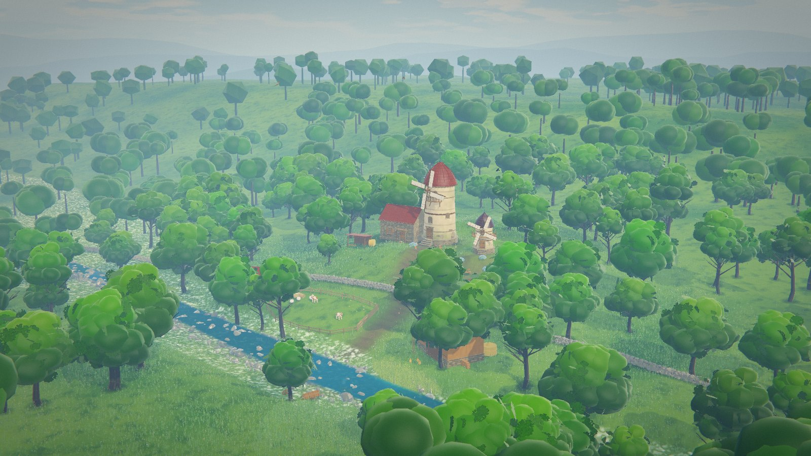
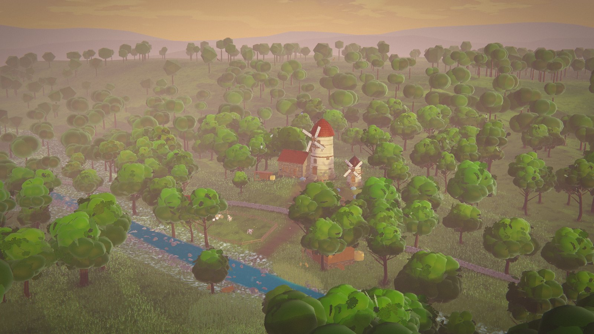
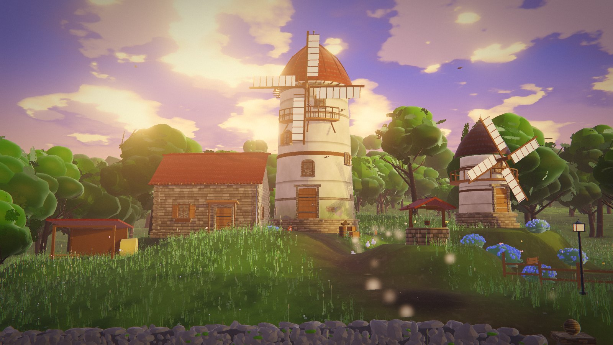
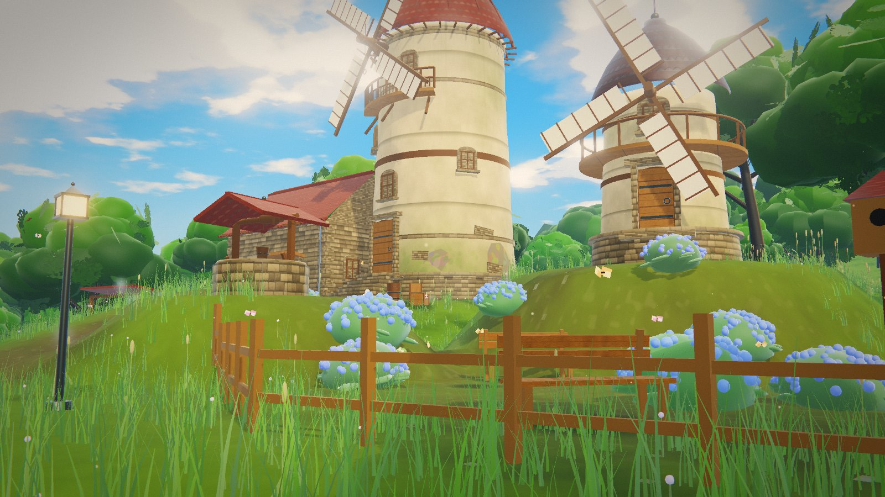
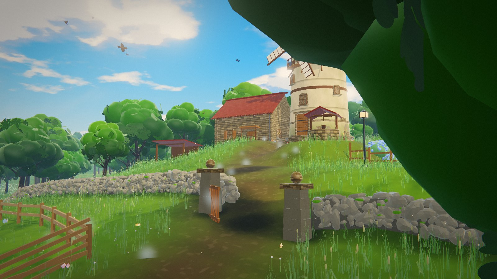
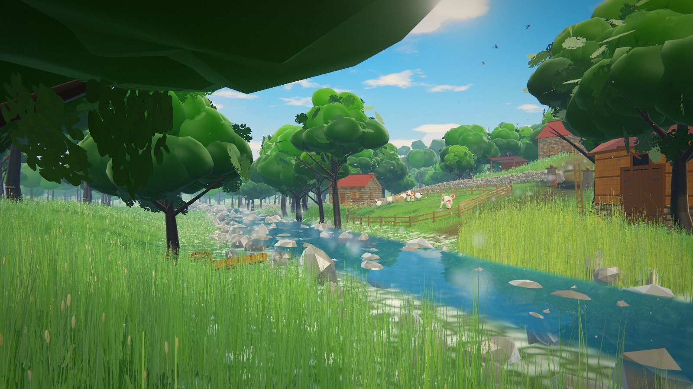
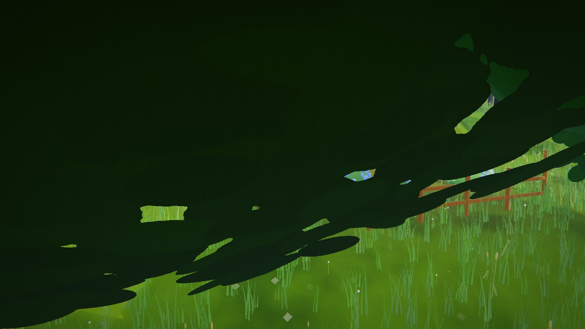
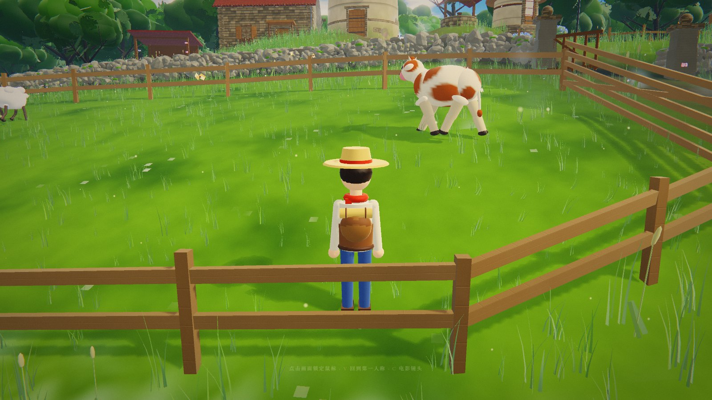

# 風車の丘 · The Windmill Hill

一个完全程序化生成的实时 3D 场景 Demo —— 风车、石墙、河谷、花园、牧场，参考吉卜力风格的动画背景重建。
**没有任何外部模型 / 贴图资源**：地形、建筑、植被、云、水面法线、石材与木纹全部在运行时用代码与 Canvas 生成。

### ▶ **[在线试玩 · cl0ud-99.github.io/windmill-hill](https://cl0ud-99.github.io/windmill-hill/)**

打开即自动播放一段约 57 秒的电影镜头；点击画面可随时接管为第一人称漫游。按 `T` 切换白昼 / 黄昏。



---

## 白昼 / 黄昏

按 `T` 在 2.4 秒内平滑过渡，不是简单换色：太阳压到 11.5°、光色转橘红、天顶转靛蓝、
云的受光面与雾霭整体偏暖、影子拉长一倍多、辉光与体积光同步加强。

| 白昼 | 黄昏 |
|---|---|
|  |  |



---

## 场景一览

| | |
|---|---|
|  |  |
|  |  |



> 全部为浏览器实时渲染截图（1600×900），无后期合成。

---

## 运行

```bash
npm install
npm run dev      # http://localhost:5173
npm run build    # 产出 dist/
```

需要支持 WebGL2 的浏览器（Chrome / Edge / Firefox 均可）。

---

## 操作

| 键 | 功能 |
|---|---|
| 点击画面 | 进入第一人称漫游（指针锁定） |
| `W A S D` | 行走 |
| 鼠标 | 环视 |
| `Shift` | 疾行（3.2×） |
| `Space` / `Ctrl` | 上升 / 下降 |
| `V` | 切换 第一人称 / 人物（第三人称）视角 |
| `C` | 播放 / 退出电影镜头（8 个镜头，约 57 秒） |
| `T` | 白昼 ⇄ 黄昏 |
| `H` | 隐藏界面 |
| `M` | 开启环境音（风、鸟、水） |

---

## 场景构成

**世界尺度 840 × 840 米，单位为真实米制。** 相机活动区约 300 m，外面是七圈逐渐稀疏的森林直到远山。

### 建筑
- **主风车**：高 18 m 的锥形石塔，红瓦穹顶、木质回廊、吊臂、四扇拱窗、石砌基座，四片木格帆实时旋转
- **小风车**：高 8.6 m 的矮胖塔身，灰蓝石板顶、木质回廊、四片木格帆（转速更快）
- **磨坊主屋**：8.4 × 5.9 m，山墙红瓦屋顶、烟囱、拱门、百叶窗、窗台花箱
- **村落**：木构谷仓（石基 + 干草阁楼 + 双开门）、石砌小屋（烟囱 + 菜园）、敞棚、石井、干草堆、木梯
- **干砌石墙**：约 200 m，**8987 块**独立石块实例化堆砌，含门柱与半开木栅门
- **石材阶梯**：主风车与小风车的高位门各有一段弧形石阶，用自建的楔形几何（不是 CylinderGeometry 的扇区，那样两侧会空心）

### 自然
- **河流**：平面反射水面（实时镜像相机 + 斜裁剪近平面）、双层滚动法线、16 位高度图算水深、岸边泡沫、水下焦散、**1200 块河石**、**5200 丛芦苇**
- **牧场**：木栅栏围出的牛羊活动区，五栏门、干草卷
- **花园**：绣球花丛、长椅、路灯、陶盆、鸟屋、木栅栏、小木桥
- **植被**：**约 15.3 万丛草（约 70 万片草叶）**，五层由近到远铺满全场；**1329 棵**程序化树分七圈布置，三级 LOD；7500 朵野花、5000 丛结籽草
- **远景**：三层远山、程序化积云天空、大气透视

### 生物
- **卡通动物**：13 只（2 牛 / 4 羊 / 1 猫 / 1 狗 / 3 鸡 / 2 鸭）。统一的「髋球」腿架（枢轴就在髋部，关节处不会脱节），带屈膝、脚掌跟随、眨眼、尾巴摆动，会在牧场与院子里随机漫步 / 驻足 / 低头吃草
- **鸟类**：7 个品种（海鸥、乌鸦、燕子、鹰、灰鹤、绿头鸭、麻雀），23 只，朝向驱动的飞行（偏航 / 俯仰 / 侧倾），在盘旋与游荡之间切换，扑翼与滑翔交替，三级 LOD
- **蝴蝶**：26 只，5 套配色，绕花丛飞舞

### 氛围
- **花粉浮尘**：分三层 —— 贴地浮絮（640）/ 中层花粉（1500）/ 高空细尘（900），各层高度、大小、漂移速度、透明度都不同，逆光提亮
- **河面薄雾**：主河道 200 团 + 尾水渠 54 团，贴水面缓慢涡流，黄昏自动加重
- **炊烟**：谷仓与小屋烟囱的程序化上升烟柱

---

## 技术要点

### 光照与阴影
- **自定义风格化着色器**（`src/core/materials.js`）：三段式卡通光照 + 冷调阴影 + 菲涅尔天空反射 + 边缘光 + 叶片透光 + 手绘感噪声扰动 + 高度衰减大气雾
- **接触硬化阴影**：`BasicShadowMap` 拿到原始深度，着色器里用中心采样求出「接收点与遮挡物的间距」，再按间距把 Vogel 盘半径从 0.7 texel 铺到 7.5 texel —— 贴着接触点的地方几乎不模糊，投得远的影子才变软。8 样本配交错梯度噪声逐像素旋转采样盘
- **阴影相机随太阳高度角自适应**：`R = 55 × max(1, 0.60 / sin(高度角))`，上限 143 m。白昼 55 m（2.7 cm/texel），黄昏 143 m —— 否则 11.5° 的太阳让 18 m 高的塔投出 90 m 长影，会被取景框硬切
- **地面反弹色**：从 splat 图烘一张 256² 的「地面反弹色」（草→暖黄绿 / 土→暖褐 / 湿→冷蓝灰），所有材质按世界坐标采样，只加在朝下的部位。屋檐下、树叶背面、石头背光面会染上脚下地面的颜色
- **云影**：大尺度噪声在着色器内生成缓慢移动的明暗
- **烘焙 AO**：静态遮挡关系烘成一张 2048² 贴图（220 m 核心区），地表与草的实例色各乘一次，运行时零开销
- **昼夜预设**（`src/core/tod.js`）：一张扁平的颜色 / 数值表 + 平滑插值，一次驱动材质共享参数、天空、平行光、后处理四处

### 渲染
- **后期管线**：HalfFloat + 2× MSAA → 自定义景深（薄透镜弥散圆，电影模式）→ UnrealBloom → 屏幕空间体积光（56 次径向采样，按到太阳的屏幕距离加权）→ ACES 色调映射 + 分离色调 + S 曲线 + 暗角 + 颗粒
- **材质**：法线贴图（石材鼓包 / 筒瓦弧面 / 木板凹槽的真实高度场）、垂直脏污渐变、粗糙度扰动、潮湿高光
- **大气**：高度雾 + 朝向太阳的散射 + 距离去饱和

### 水体
- 镜像相机实时渲染反射（含斜裁剪近平面，避免水下几何进入反射）
- 双层滚动法线贴图 + 菲涅尔混合 + 16 位编码的高度图计算水深
- 深度着色、岸边泡沫、太阳高光、水下焦散

### 程序化生成
- 地形：多倍频噪声 + 丘陵 + 河道开凿 + 建筑台基平整，720² 网格
- 贴图：灰泥、石墙、红瓦、木纹、树皮、水面法线、叶簇 —— 全部 Canvas 逐像素生成
- 法线：每种材质在生成颜色图时同步绘制高度图，再由高度推导切线空间法线
- 树：主干分段弯曲 + 5 根主枝与二级枝骨架 + 三层明度的球团树冠 + 三级尺寸叶簇卡片，4 个树种
- 草地：单丛几何体实例化 + 实例色相扰动 + 顶点风场

---

## 目录

```
src/
  core/        着色器、程序化贴图、几何工具、噪声、昼夜预设
  world/       地形、天空、建筑、石墙、道具、植被、水体、粒子
  camera/      漫游控制器、第三人称控制器、电影镜头
  character/   程序化人物、卡通动物
  post/        后期管线（含自定义景深）
  ui.js        界面
  audio.js     程序化环境音
  main.js      装配与主循环
```

---

*Built with Three.js r187 · Vite · 全部内容程序化生成*
